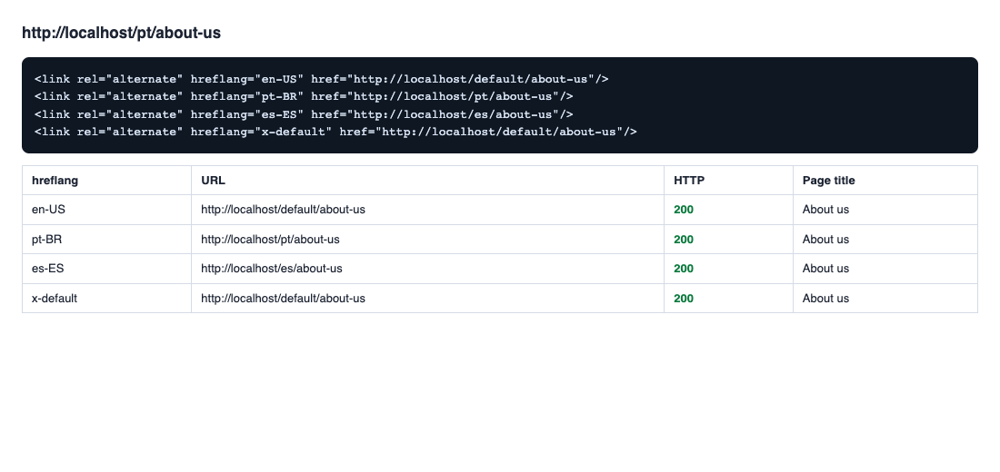
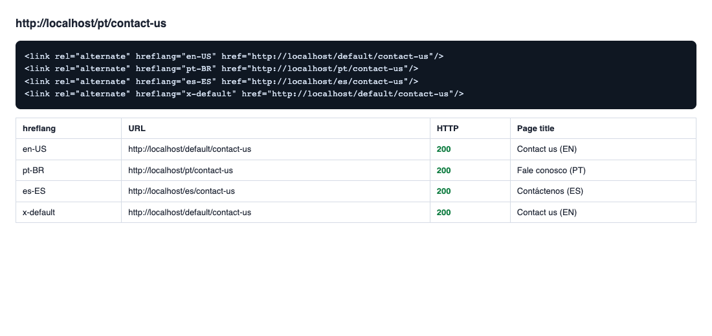
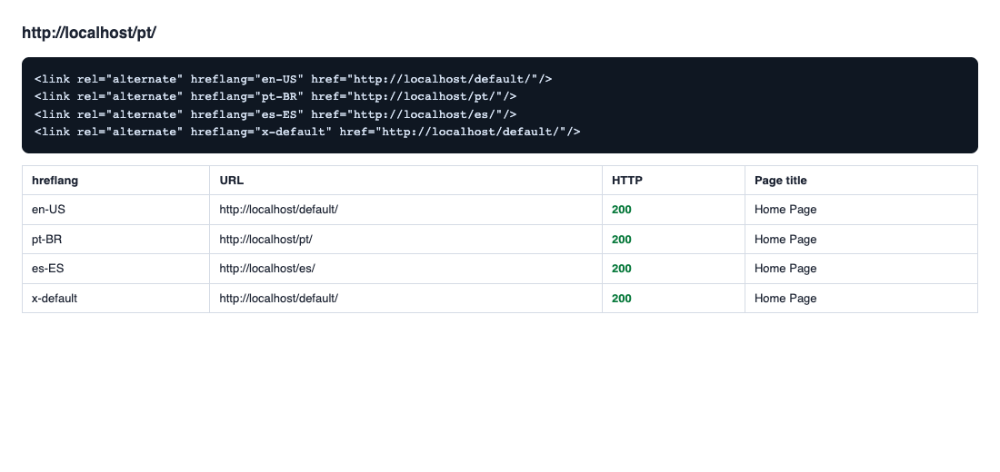
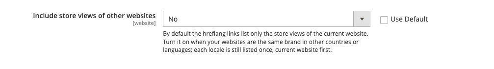

# CMS Hreflang for Magento 2

[](https://github.com/roni-clei-santos/Roni_CmsHreflang/actions/workflows/ci.yml)

Adds the `hreflang` alternate links (and `x-default`) to **CMS pages and to the CMS home page**, so search engines know which
URL to show to which language or region.

## The problem it solves

A store with several store views (languages, countries) shows the same CMS page, "About us", "Contact us", the home page, at
one URL per store view. Without `hreflang`, search engines treat them as duplicates, or show the wrong language to the shopper.
Magento core adds no `hreflang` to CMS pages.

This module lists, in the `<head>` of every CMS page, the URL of that page in each store view that serves it, each with its
language-region (`pt-BR`, `es-ES`...) read from the locale of the store view, plus an `x-default`:

```html
<link rel="alternate" hreflang="en-US" href="https://example.com/default/about-us"/>
<link rel="alternate" hreflang="pt-BR" href="https://example.com/pt/about-us"/>
<link rel="alternate" hreflang="es-ES" href="https://example.com/es/about-us"/>
<link rel="alternate" hreflang="x-default" href="https://example.com/default/about-us"/>
```

## Features

- Works on CMS pages and on the **CMS home page** (the base URL of each store view).
- Every link is reciprocal and the page references itself: each store view lists the same set.
- **Only active store views** whose CMS page is active and assigned; a disabled store view or page is never listed.
- **One link per hreflang value**, never a repeated locale.
- `x-default` points to the default store view of the current website, when it serves the page.
- URLs follow "Add Store Code to Urls", on or off, because they come from the store view's own base URL.
- Pages that share an identifier across languages (one "Contact us" page per language) link to each other.
- Other websites are listed only when you ask for it (setting per website, off by default).
- Cache tags of the pages behind the links, so editing any of them refreshes the cached page.
- Translated to English and Brazilian Portuguese (admin labels).

## Compatibility

| | |
|---|---|
| Declared | Magento Open Source / Adobe Commerce **2.4.7+** (`magento/framework` `^103.0.7`), PHP **8.2 – 8.3** |
| Tested end-to-end | Magento Open Source **2.4.8-p4**, PHP 8.3, MariaDB 10.6, OpenSearch 2.12, Luma theme with the sample data, two websites and six store views, with "Add Store Code to Urls" on and off |
| CI | phpcs (Magento2 standard), phpmd, phpcpd, phpstan level 9 and PHPUnit on PHP 8.2 and 8.3 |

The end-to-end tests (Playwright, in `e2e/`) were run against the Magento 2.4.8-p4 store above.

## Installation

The module is installed straight from this repository with Composer:

```bash
composer config repositories.roni-cms-hreflang vcs https://github.com/roni-clei-santos/Roni_CmsHreflang
composer require roni/module-cms-hreflang:^2.0

bin/magento module:enable Roni_CmsHreflang
bin/magento setup:upgrade
bin/magento setup:di:compile                  # production mode only
bin/magento cache:flush
```

## Configuration

`Stores > Configuration > Roni > CMS Hreflang > General`. Choose the website in the scope switcher first.

| Field | Meaning |
|---|---|
| Include store views of other websites | No (default): the links list only the store views of the current website. Yes: the active store views of the other websites are listed too, after the ones of the current website, still one link per locale. Turn it on when your websites are the same brand in other countries; leave it off when they are different brands. |

Everything else comes from the store: the **locale** of each store view (`Stores > Configuration > General > General > Locale
Options`), the **base URL** and "Add Store Code to Urls", the **home page** (`Content > Design > Configuration` or
`Stores > Configuration > General > Web > Default Pages`), and the **store views and pages** that are active.

### How the links are chosen

For the page being viewed, in this order:

1. The candidate store views are the active store views of the current website (and of the other websites when the setting
   is on), the current website first, then by website, sort order and id.
2. Each store view looks the page up by its URL key (identifier): the page assigned to that store view wins over a page
   assigned to All Store Views, and an inactive page does not count. A store view without a page is left out.
3. The hreflang value is the locale of the store view (`pt_BR` becomes `pt-BR`). When two store views have the same value,
   the first one wins.
4. `x-default` is added when the default store view of the current website serves the page.

The CMS home page (`/`) uses the home page configured for each store view and the **base URL** of the store view. The same
page opened at `/home` is an ordinary page with its own URL.

### Pages with different URL keys (limitation)

Magento keeps no relation between two CMS pages of different store views other than their URL key. The module therefore links
pages that have the **same** URL key: `contact-us` for English, Portuguese and Spanish, each page assigned to its store view.
Pages with different URL keys (`about-us` in English, `sobre-nos` in Portuguese) are different pages for Magento and are
**not** linked: each one only references itself. If you want them linked, give them the same URL key, one page per store view.
This is a documented limitation; relating pages with different keys would need a new field on the CMS page.

### Caching

The links are part of the cached page. The cache tags of the pages behind the links are added to it, so editing or disabling
any page of the set refreshes the cached page. Two things are not tracked, and need `bin/magento cache:flush`, as Magento asks for any
configuration change:

- a page that **joins** the set: a new page that shares the URL key of an existing one, or a disabled page that is enabled
  again (the cached pages do not know it exists);
- what is read from the configuration: a **locale**, a **base URL**, the **status of a store view**, or this module's setting.

## Screenshots

| | |
|---|---|
|  |  |
| A page for All Store Views, with "Add Store Code to Urls" on: every link answers 200. | Three pages that share the URL key `contact-us`, one per language, each linking to the others. |
|  |  |
| The CMS home page: the base URL of each store view. | The setting at website scope. |

They were captured by the end-to-end tests, which read the links in a real browser and open each one, so they show what the
module renders.

## Development

```bash
./setup-dev.sh        # enables the git hooks (core.hooksPath = .githooks)
composer check        # blacklist, phpcs (warnings block), phpmd, phpcpd, phpstan level 9, tests-exist, multi-store, coverage
```

The dependencies come from a public mirror of the original Magento packages, no `repo.magento.com` keys needed
(`composer config -g repositories.magento-mirror composer https://mirror.mage-os.org/`). The same checks run in CI on PHP 8.2
and 8.3; PHPUnit must keep every file at 70% line coverage or more. `CLAUDE.md` describes the structure and the rules.

The `e2e/` folder has the Playwright tests and the scenario they run against (two websites, a disabled store view, pages for
all, some and one store view, one page per language, the CMS home page), with the store code in the URL on and off; see
`e2e/README.md`.

## About

The first version of this module (1.0.0) was born as the technical challenge of a hiring process, and it got me the job.
2.0.0 is the same idea rebuilt to the standard of my other Magento modules.

## License

[MIT](LICENSE) © Roni Clei Santos
